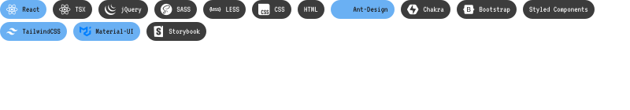
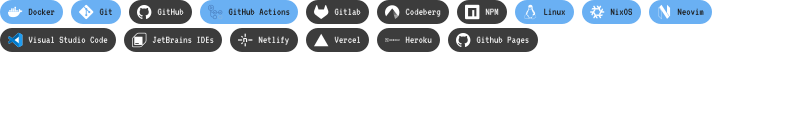
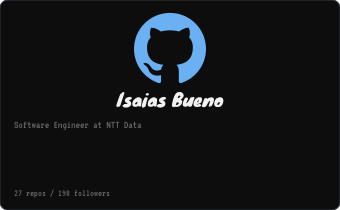
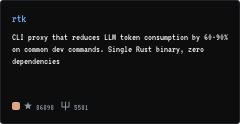
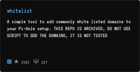
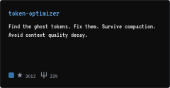
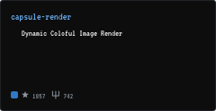
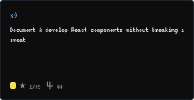
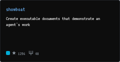
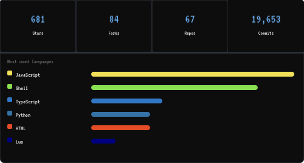

About Me

<ul align="left">
<li align="left">Building AI-powered tools and infrastructure — from agentic coding workflows and multi-agent orchestration systems to LLM-integrated applications. Check out my <a href="https://github.com/Thomashighbaugh">repos</a> for a sense of the work.</li>
<li align="left"><a href="https://github.com/Sanatana-Linux/nixos-config">NixOS</a> + <a href="https://github.com/Sanatana-Linux/nixos-awesomewm">AwesomeWM</a> + <a href="https://github.com/Thomashighbaugh/nvim-forge">Neovim</a> user (...by choice)</li>
</ul>

<strong>
Tom's Law of Software Development
</strong> 
 
 
 <em>The more convenient, useful or helpful a software is to use,   the more of a painful, tedious and/or absolutely miserable it was to  develop and then iteratively refine into such a form.</em>

 

 

Get in Touch

 

Skill Wall

**Languages**

**Frontend**

**Backend & Databases**

**DevOps & Tools**

**Design**

Follower Showcase 

<em><small>Here is one of the awesome individuals that follows me on GitHub, with a new follower highlighted daily!</small></em>

⚡ Recent Activity

 

<ul>
  <li>📝 Pushed 7 commits to <a href="https://github.com/Sanatana-Linux/nixos-config">Sanatana-Linux/nixos-config</a> on main <small><em>— yesterday</em></small></li>
  <li>📝 Pushed 1 commit to <a href="https://github.com/Thomashighbaugh/Thomashighbaugh">Thomashighbaugh/Thomashighbaugh</a> on main <small><em>— today</em></small></li>
  <li>📝 Pushed 1 commit to <a href="https://github.com/Thomashighbaugh/buchbinder">Thomashighbaugh/buchbinder</a> on main <small><em>— 2 days ago</em></small></li>
  <li>⭐ Starred <a href="https://github.com/c8r/x0">c8r/x0</a> <small><em>— yesterday</em></small></li>
  <li>📝 Pushed 2 commits to <a href="https://github.com/Sanatana-Linux/sharabha-gtk-theme">Sanatana-Linux/sharabha-gtk-theme</a> on main <small><em>— yesterday</em></small></li>
  <li>⭐ Starred <a href="https://github.com/satsvi97/lorebook-sync">satsvi97/lorebook-sync</a> <small><em>— yesterday</em></small></li>
  <li>⭐ Starred <a href="https://github.com/KritBlade/mvu-helper">KritBlade/mvu-helper</a> <small><em>— yesterday</em></small></li>
  <li>⭐ Starred <a href="https://github.com/Uberspace/lab">Uberspace/lab</a> <small><em>— 2 days ago</em></small></li>
  <li>⭐ Starred <a href="https://github.com/erosman/firemonkey">erosman/firemonkey</a> <small><em>— 2 days ago</em></small></li>
  <li>📝 Pushed 1 commit to <a href="https://github.com/Thomashighbaugh/opencode">Thomashighbaugh/opencode</a> on main <small><em>— 2 days ago</em></small></li>
  <li>⭐ Starred <a href="https://github.com/zapers/SillyTavern-Character-Card-Suggestions">zapers/SillyTavern-Character-Card-Suggestions</a> <small><em>— 2 days ago</em></small></li>
  <li>⭐ Starred <a href="https://github.com/Mubelotix/SimRepo">Mubelotix/SimRepo</a> <small><em>— 2 days ago</em></small></li>
  <li>⭐ Starred <a href="https://github.com/EnchantedRobot/jai-proxy">EnchantedRobot/jai-proxy</a> <small><em>— 2 days ago</em></small></li>
  <li>⭐ Starred <a href="https://github.com/EnchantedRobot/SillyTavern-Character-Tools-Server">EnchantedRobot/SillyTavern-Character-Tools-Server</a> <small><em>— 2 days ago</em></small></li>
</ul>

🌟 Projects I'm Following

<em>Repos I've starred that I find interesting or useful:</em>

 

Account Statistics

