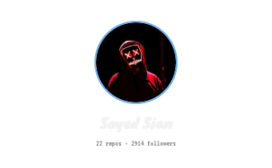
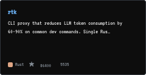
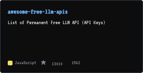
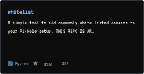
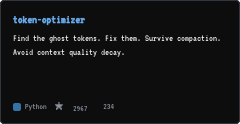
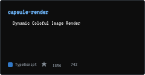
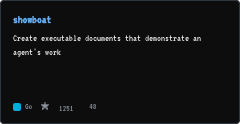
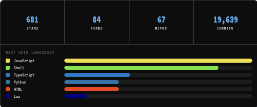

About Me

<ul align="left">
<li align="left">Building AI-powered tools and infrastructure — from agentic coding workflows and multi-agent orchestration systems to LLM-integrated applications. Check out my <a href="https://github.com/Thomashighbaugh">repos</a> for a sense of the work.</li>
<li align="left"><a href="https://github.com/Sanatana-Linux/nixos-config">NixOS</a> + <a href="https://github.com/Sanatana-Linux/nixos-awesomewm">AwesomeWM</a> + <a href="https://github.com/Thomashighbaugh/nvim-forge">Neovim</a> user (...by choice)</li>
</ul>

<strong>
Tom's Law of Software Development
</strong> 
 
 
 <em>The more convenient, useful or helpful a software is to use,   the more of a painful, tedious and/or absolutely miserable it was to  develop and then iteratively refine into such a form.</em>

 

 

Get in Touch

 

Skill Wall

**Languages**

**Frontend**

**Backend & Databases**

**DevOps & Tools**

**Design**

Follower Showcase 

<em><small>Here is one of the awesome individuals that follows me on GitHub, with a new follower highlighted daily!</small></em>

⚡ Recent Activity

 

<ul>
  <li>📝 Pushed 1 commit to <a href="https://github.com/Thomashighbaugh/opencode">Thomashighbaugh/opencode</a> on main <small><em>— yesterday</em></small></li>
  <li>⭐ Starred <a href="https://github.com/adiimanav/moreland">adiimanav/moreland</a> <small><em>— today</em></small></li>
  <li>⭐ Starred <a href="https://github.com/Lilium-Linux/solium">Lilium-Linux/solium</a> <small><em>— today</em></small></li>
  <li>⭐ Starred <a href="https://github.com/jihoo12/skills">jihoo12/skills</a> <small><em>— today</em></small></li>
  <li>📝 Pushed 1 commit to <a href="https://github.com/Sanatana-Linux/nixos-config">Sanatana-Linux/nixos-config</a> on main <small><em>— today</em></small></li>
  <li>⭐ Starred <a href="https://github.com/kyechan99/capsule-render">kyechan99/capsule-render</a> <small><em>— today</em></small></li>
  <li>📝 Pushed 1 commit to <a href="https://github.com/Thomashighbaugh/buchbinder">Thomashighbaugh/buchbinder</a> on main <small><em>— 2 days ago</em></small></li>
  <li>⭐ Starred <a href="https://github.com/alexgreensh/token-optimizer">alexgreensh/token-optimizer</a> <small><em>— yesterday</em></small></li>
  <li>⭐ Starred <a href="https://github.com/junkyard-computing/junkyard-boot-img">junkyard-computing/junkyard-boot-img</a> <small><em>— yesterday</em></small></li>
  <li>⭐ Starred <a href="https://github.com/Nitrux/valenz">Nitrux/valenz</a> <small><em>— 2 days ago</em></small></li>
  <li>⭐ Starred <a href="https://github.com/denson9874/ExpressiveLauncher">denson9874/ExpressiveLauncher</a> <small><em>— 2 days ago</em></small></li>
</ul>

🌟 Projects I'm Following

<em>Repos I've starred that I find interesting or useful:</em>

 

Account Statistics

