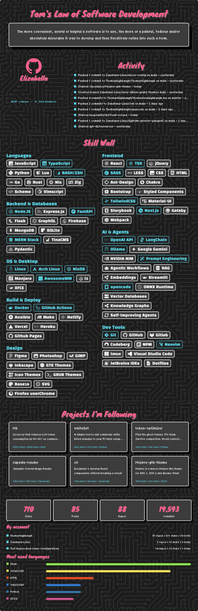

Links

<strong>Follower of the day</strong> <a href="https://github.com/Elizabella">@Elizabella</a>

<strong>Projects I'm following</strong>
<ul><li><a href="https://github.com/rtk-ai/rtk">rtk-ai/rtk</a></li><li><a href="https://github.com/anudeepND/whitelist">anudeepND/whitelist</a></li><li><a href="https://github.com/alexgreensh/token-optimizer">alexgreensh/token-optimizer</a></li><li><a href="https://github.com/kyechan99/capsule-render">kyechan99/capsule-render</a></li><li><a href="https://github.com/c8r/x0">c8r/x0</a></li><li><a href="https://github.com/vinceliuice/Mojave-gtk-theme">vinceliuice/Mojave-gtk-theme</a></li></ul>

Contact Me!

&nbsp;&nbsp;&nbsp;&nbsp;&nbsp;&nbsp;

&nbsp;&nbsp;&nbsp;&nbsp;&nbsp;&nbsp;&nbsp;&nbsp;

