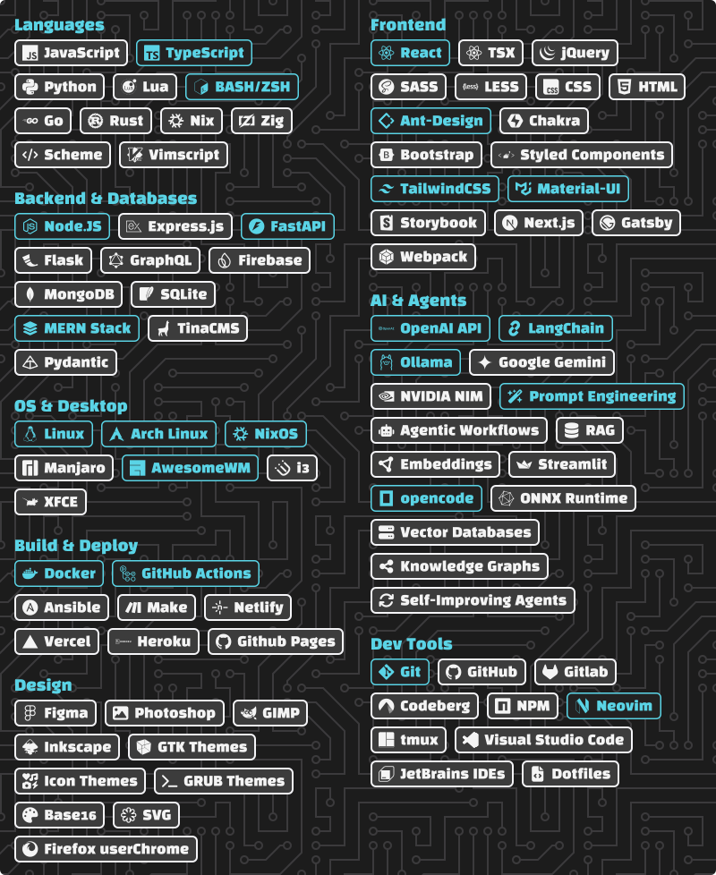
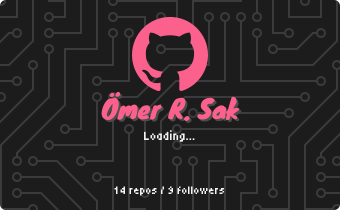
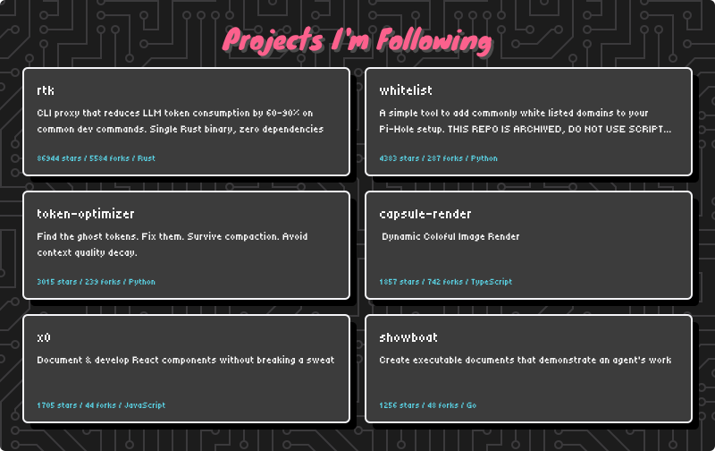
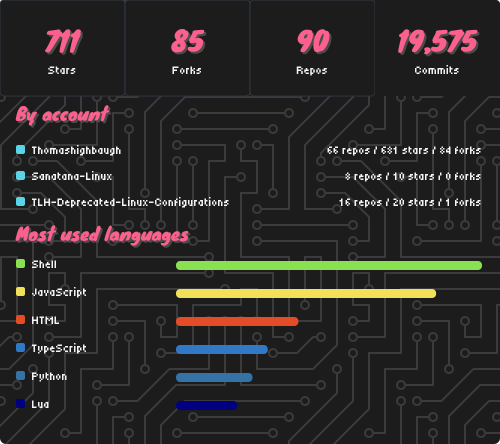

&nbsp;&nbsp;&nbsp;&nbsp;&nbsp;&nbsp;

About Me

<ul align="left">
<li align="left">Building AI-powered tools and infrastructure — from agentic coding workflows and multi-agent orchestration systems to LLM-integrated applications. Check out my <a href="https://github.com/Thomashighbaugh">repos</a> for a sense of the work.</li>
<li align="left"><a href="https://github.com/Sanatana-Linux/nixos-config">NixOS</a> + <a href="https://github.com/Sanatana-Linux/nixos-awesomewm">AwesomeWM</a> + <a href="https://github.com/Thomashighbaugh/nvim-forge">Neovim</a> user (...by choice)</li>
</ul>

 

 

Get in Touch

&nbsp;&nbsp;&nbsp;&nbsp;&nbsp;&nbsp;&nbsp;&nbsp;

 

Skill Wall

Follower Showcase 

<em><small>Here is one of the awesome individuals that follows me on GitHub, with a new follower highlighted daily!</small></em>

⚡ Recent Activity

🌟 Projects I'm Following

<em>Repos I've starred that I find interesting or useful:</em>

 

Account Statistics

